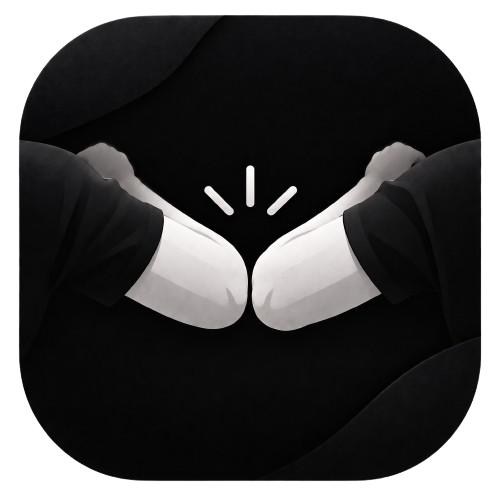
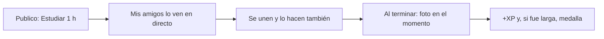
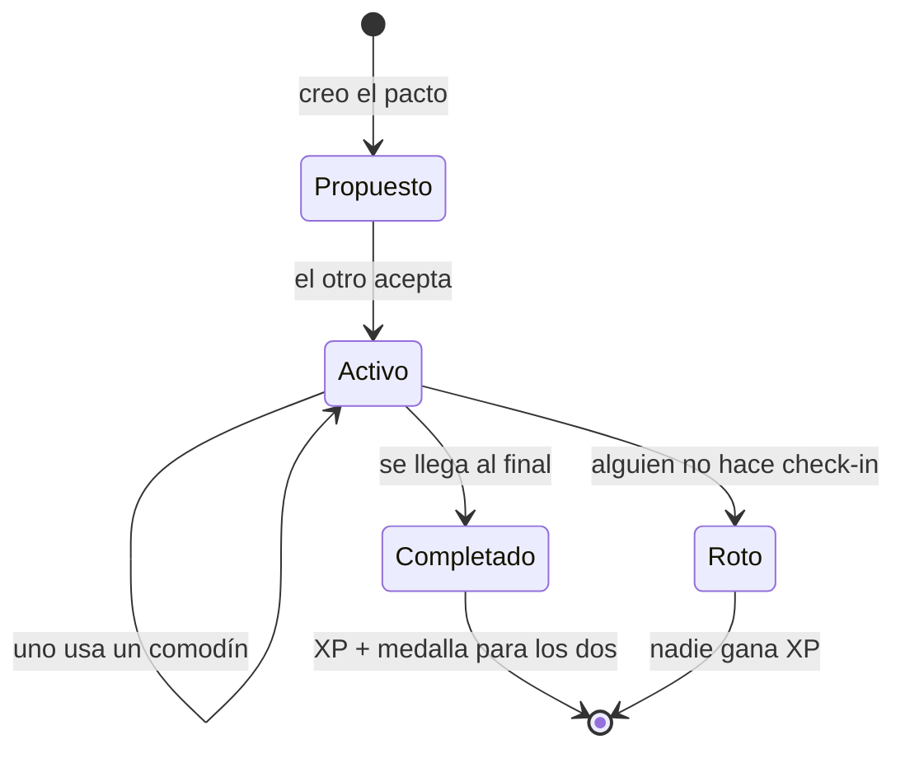
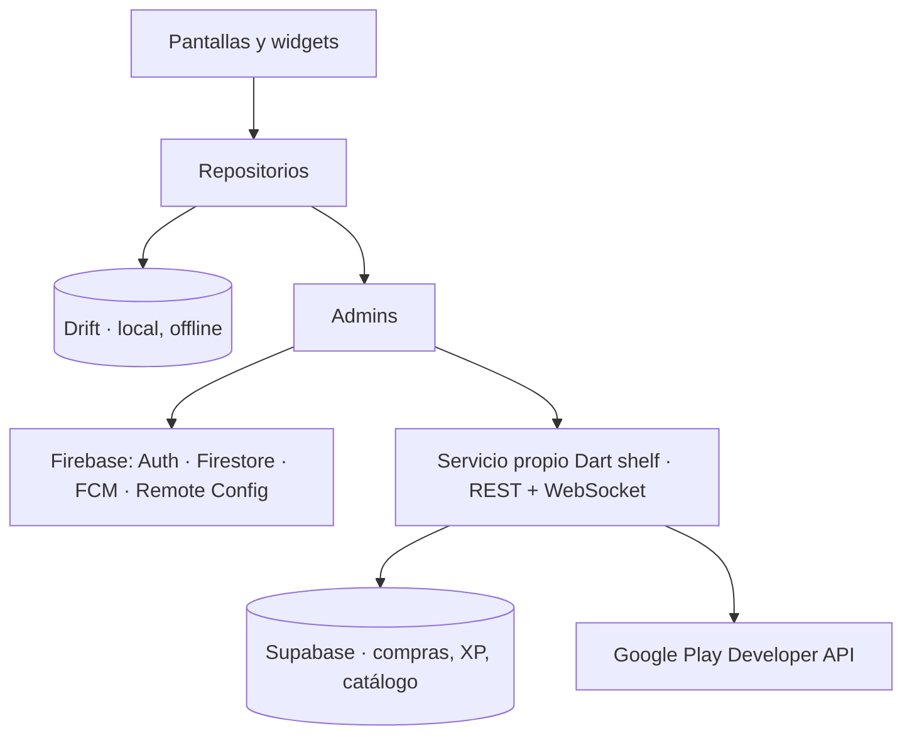

<p align="center">
  
</p>

<h1 align="center">Codo</h1>
<p align="center"><b>Cumple tus objetivos acompañado.</b><br/>
Hazlo ahora con quien está haciendo lo mismo, o comprométete con un amigo en un pacto.</p>

<p align="center">
Flutter · Firebase · Drift · Dart shelf · Supabase · Google Play
</p>

---

## 🎯 El problema
Las apps de organización se abandonan: apuntar tareas es fácil, pero cumplirlas solo cuesta. En compañía cuesta menos. Por eso estudiamos en biblioteca y quedamos para ir al gimnasio.

**Codo convierte tus objetivos en algo compartido.**

## ✨ Cómo funciona

### ⏱️ Ahora — haz tareas acompañado en directo
Publicas lo que vas a hacer y tus amigos se unen haciendo lo mismo. Ves en tiempo real quién está y cuánto le queda.



### 🤝 Pacto — un reto con alguien que no te deja tirar la toalla
Eliges un objetivo y una duración, y lo haces con un amigo o con alguien del tablón de pactos abiertos. Cada día los dos hacéis check-in con una prueba de avance, y el compañero la valida. **Si uno falla, pierden los dos.**



### 📱 Secciones
| Hoy | Ahora | Pactos | Amigos | Perfil |
|:---:|:---:|:---:|:---:|:---:|
| Tus objetivos del día, check-ins pendientes y quién está activo | Sesiones en directo de tus amigos | Tus pactos, invitaciones, tablón y plantillas | Ranking entre amigos y solicitudes | Nivel, medallas, ajustes y Codo Plus |
| _captura pendiente_ | _captura pendiente_ | _captura pendiente_ | _captura pendiente_ | _captura pendiente_ |

> **En la fase 1** están hechas **Pactos** (lista y detalle) y **Perfil** (medallas y cerrar sesión). Hoy, Ahora y Amigos ya tienen su sitio en la barra inferior, pero son pantallas vacías hasta las fases siguientes.

### 🏅 Progreso
- **XP → niveles** con nombre propio.
- **Medallas** por objetivos cumplidos: pactos completados, sesiones largas…
- El ranking es **entre amigos** y los puntos **no se compran**. Así hacer trampa no tiene premio.

### 💎 Codo Plus y comodines
| Producto | Tipo | Qué da |
|---|---|---|
| Comodín | Consumible | Saltarte un día de check-in sin romper el pacto |
| Codo Plus | Pago único | Sin anuncios, pactos ilimitados y estadísticas |

---

## 🏗️ Arquitectura



### Estructura de carpetas y por qué está dividida así
```
lib/
├── app/           # MaterialApp, rutas con nombre, tema
├── l10n/          # Textos ES/EN
├── models/        # Clases de dominio y sus conversores
├── admins/        # Hablan con fuentes externas: Firebase, almacenamiento, preferencias del móvil, API, Billing…
├── repositories/  # Única puerta de datos para la UI
├── screens/       # Las pantallas, una carpeta por sección o flujo
├── widgets/       # Piezas reutilizables
└── utils/         # Funciones sueltas sin pantalla (p. ej. a qué ruta ir al arrancar) y datos de ejemplo
```
Cada capa tiene una única responsabilidad. **Las pantallas no saben de dónde vienen los datos**: se los pide al repositorio, que decide si los lee de la base de datos local o de la nube. Así puedo cambiar Firestore por otra fuente, o probar la lógica con una base de datos en memoria, sin tocar la interfaz. Los **modelos** están separados para que la app trabaje con objetos tipados y no con mapas sueltos.

### Navegación y pantallas
- El onboarding solo sale la primera vez: «visto» se guarda con `shared_preferences` (clave `onboarding_seen`) en `PreferencesAdmin`, y el splash lo lee y decide el destino con `startupRoute()`.
- `HomeScreen` es la carcasa de la app: una barra inferior (`CodoNavBar`, el `NavigationBar` de Material 3) y un `IndexedStack` con las 5 secciones, que conserva el estado de cada una al cambiar de pestaña.
- Las rutas con nombre están en un único sitio (`AppRoutes`) y se resuelven con `onGenerateRoute`. Los argumentos viajan en una clase tipada (`PactDetailArgs`); si llegan mal o la ruta no existe, se muestra una pantalla de error en vez de romper.
- Toda pantalla que pide datos pinta cuatro casos: cargando, vacío, error con «Reintentar» y datos (por ejemplo `PactsScreen` y `MedalGrid`). Las listas escuchan un `Stream` del repositorio con `StreamBuilder`, que cancela la suscripción al cerrar la pantalla.

### Datos en Firestore
Un único admin (`FirestoreAdmin`) conoce Firestore y entrega cada colección con su conversor (`withConverter`), de modo que de ahí salen siempre modelos y nunca mapas. Los modelos leen cada campo con funciones seguras (`field_readers.dart`): si un dato falta o tiene otro tipo, usan un valor por defecto en vez de romper la pantalla.

| Colección | Documento | Campos | Modelo |
|---|---|---|---|
| `users` | id = `uid` de la cuenta (se crea al registrarse) | `displayName`, `xp`, `badges`, `createdAt`, `photoUrl?`, `bio?` | `Profile` |
| `pacts` | un pacto | `title`, `partnerName`, `daysDone`, `daysTotal`, `createdAt` | `Pact` |
| `badges` | una medalla del catálogo | `name`, `description`, `xpReward`, `imageUrl` | `Medal` |

En el código el concepto se llama **medalla** (`Medal`, `MedalRepository`, `Profile.medals`), pero la colección y la clave del perfil se guardan como `badges`: el conversor del modelo es el único sitio que conoce ese nombre.

**Reglas de Firestore** (Firebase Console → Firestore Database → Reglas):
```
rules_version = '2';
service cloud.firestore {
  match /databases/{database}/documents {
    // cada usuario lee y escribe solo su propio perfil
    match /users/{uid} {
      allow read, write: if request.auth != null && request.auth.uid == uid;
    }
    // pactos y medallas: solo lectura para quien tenga sesión
    match /pacts/{id}  { allow read: if request.auth != null; }
    match /badges/{id} { allow read: if request.auth != null; }
  }
}
```
Pendiente para la fase 2: los pactos no tienen dueño y los lee cualquier usuario con sesión; habrá que guardar sus participantes y limitar la lectura a ellos.

---

## 🚀 Guía de arranque (en un equipo limpio)

### Requisitos
- Flutter SDK estable (Dart ^3.13). Compruébalo con `flutter doctor`.
- Android Studio con un emulador Android (API 34 o superior) o un móvil con depuración USB.
- Google Chrome (para la versión web).

### Pasos
```bash
git clone https://github.com/Aitoorchs7/codo.git
cd codo
flutter pub get
```

### Configuración de Firebase
La app necesita dos ficheros que **no están en el repositorio** (ver la tabla de abajo): `android/app/google-services.json` y `lib/firebase_options.dart`. Hay dos maneras de tenerlos:

**A. Usar el proyecto de Firebase de Codo (recomendada para corregir).** El autor entrega los dos ficheros por separado. Cópialos en sus rutas y la app se conecta al proyecto de Codo, que ya tiene los datos de ejemplo (6 pactos y 6 medallas).

**B. Usar tu propio proyecto de Firebase.**
1. En la [consola de Firebase](https://console.firebase.google.com) crea un proyecto.
2. **Authentication** → Método de acceso → activa **Correo electrónico/contraseña**.
3. **Firestore Database** → crea la base de datos y pega las reglas de la sección «Datos en Firestore».
4. Instala la CLI de Firebase y FlutterFire, inicia sesión y configura el proyecto desde la carpeta del repositorio. Esto genera los dos ficheros:
   ```bash
   dart pub global activate flutterfire_cli
   flutterfire configure
   ```
5. Sube los datos de ejemplo con `seedSampleData()` (`lib/utils/example_data.dart`). Es seguro repetirlo: usa ids fijos y no duplica. Mientras lo haces, las reglas deben permitir `write` en `pacts` y `badges`; vuelve a dejarlas solo en lectura al terminar.

### Ejecutar
```bash
flutter run              # emulador o móvil Android
flutter run -d chrome    # navegador
flutter test             # pruebas
```
**Primer arranque:** en la pantalla de acceso, regístrate con un correo y una contraseña. Se crea tu perfil en `users/{uid}` y entras en la app.

### Ficheros que NO están en el repositorio (y por qué)
| Fichero | Para qué sirve | Por qué no se sube |
|---|---|---|
| `android/app/google-services.json` | Conectar Android con Firebase | Identifica el proyecto de Firebase; se mantiene fuera por seguridad |
| `lib/firebase_options.dart` | Datos del proyecto Firebase para todas las plataformas (lo genera `flutterfire configure`) | Identifica el proyecto de Firebase; se mantiene fuera por seguridad |
| `android/key.properties`, `*.jks` | Firmar el .aab de release | Quien tenga la clave podría publicar versiones en mi nombre |
| `.env` | URLs y claves del servicio propio | Son credenciales |

---

## 🧪 Pruebas
**Automáticas** (16 pruebas con `flutter test`, sin Firebase real): ruta de arranque según sesión y onboarding, preferencias con valor corrupto, un mensaje por cada error de acceso, lectores seguros de campos y progreso de un pacto con datos extremos.

**Manuales** en Android y web. Registro completo (26 pruebas, 14/10/2026) en [`docs/pruebas.md`](docs/pruebas.md). Resumen:

| Qué se probó | Esperado | Resultado Android | Resultado web |
|---|---|---|---|
| Splash con imagen y con URL rota | Imagen o estado de error, y sigue navegando | Correcto | Correcto (más rápido) |
| Onboarding: primera vez, no se repite, «Saltar» | 3 páginas solo la primera vez | Correcto | Correcto |
| Registro: correo usado, contraseña débil, correo inválido | Un mensaje concreto por error | Correcto | Correcto |
| Acceso, sesión persistente y cerrar sesión | Entra, conserva la sesión y «atrás» no vuelve a Home | Correcto | Correcto |
| Barra inferior | Cambia de sección y conserva el estado | Correcto | Correcto |
| Pactos y medallas: datos, vacío, error, imagen rota | 4 estados sin romper | Correcto (la carga no llega a verse, va muy rápido) | Correcto |
| Detalle de pacto | Abre el pacto correcto y vuelve | Correcto | Correcto |
| Tema claro/oscuro, letra grande, ancho de ventana | Todo legible, sin desbordes | Correcto | Correcto |

**Diferencias:** tras cerrar sesión, Android muestra dos avisos `PERMISSION_DENIED` en el log y el navegador ninguno (no se ven en pantalla; ver hallazgo 1 de `docs/pruebas.md`). «Atrás» sale de la app en Android y no hace nada en web.

## 🤖 Trabajo con IA
Este proyecto se desarrolla con asistentes de IA, de forma documentada:
- [`CLAUDE.md`](CLAUDE.md): arquitectura, normas y lo que el agente no debe tocar.
- [`.claude/`](.claude): agentes, skills y comandos propios.
- [`IA.md`](IA.md): bitácora de qué pedí, qué me dio y qué corregí.

## 🗺️ Estado del proyecto
- [X] **Fase 1** · Arranque: splash, onboarding, cuenta, Firestore, navegación (18/10/2026). Hecho: splash, onboarding, acceso, Firestore, barra inferior, pactos, medallas y rutas con argumentos. Pruebas Android/web hechas. Falta: PDF de entrega y envío
- [ ] **Fase 2** · Datos que duran: Drift, sincronización, copias (04/12/2026)
- [ ] **Fase 3** · Servicio: API, WebSocket, notificaciones, validación de compras (29/01/2027)
- [ ] **Fase 4** · Cobrar y publicar: Billing, AdMob, seguridad, Google Play (19/02/2027)

---
<p align="center">Proyecto integrado de 2.º DAM · IES Newton-Salas · 2026/27 · Aitor</p>
