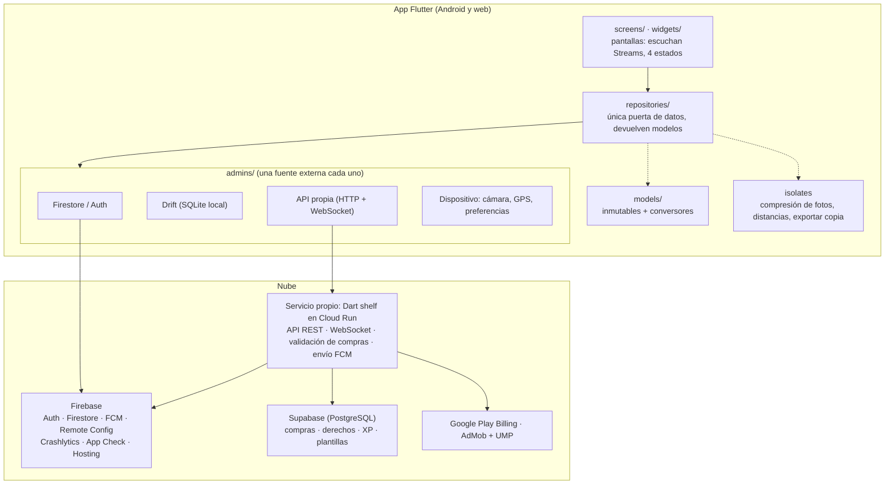

# H1 · Arquitectura, alcance y modelo de ingresos — Codo

> Entrega: 13/11/2026. **El alcance de este documento es el compromiso del proyecto: se puede ampliar, no rebajar.**
> Detalle de mecánicas y decisiones: `docs/decisiones_producto.md`.

## 1. Qué es Codo
App Flutter para cumplir objetivos **acompañado**. Dos mecánicas:
- **Ahora:** publicas lo que estás haciendo, tus amigos se unen y al terminar subís una foto como prueba.
- **Pacto** (la principal): reto entre dos personas con check-in diario validado por el compañero. Si uno falla, pierden los dos.

Secciones: Hoy · Ahora · Pactos · Amigos · Perfil. XP → niveles y medallas. Público: 16+.

## 2. Diagrama de capas

**Reglas de las capas** (fijadas en `.claude/rules/`):
- Las pantallas nunca tocan Firebase, Drift ni plugins: crean su repositorio en su `State` y escuchan su `Stream`/`Future`.
- Los repositorios combinan local y remoto, y traducen los errores a fallos de dominio con enum (`SessionFailure`, `PhotoFailure`…). La pantalla decide el texto.
- Cada admin envuelve **una** fuente externa, con la dependencia inyectable para probarlo con un falso.
- Los isolates solo hacen cálculo puro: no usan plugins ni `context`.
- Lo que el cliente no debe decidir (dar XP, cerrar un pacto, validar una compra) lo hace el servicio, no la app.

## 3. Tecnologías justificadas
| Necesidad | Tecnología | Alternativa descartada | Por qué |
|---|---|---|---|
| App Android + web | Flutter | Nativo Kotlin | Una base de código para las dos plataformas que pide el proyecto |
| Cuentas | Firebase Auth (correo + Google) | Auth propia | Recuperar contraseña, Google y seguridad sin reinventarlos |
| Datos compartidos en vivo | Cloud Firestore con `withConverter` | Solo servicio propio + SQL | Snapshots en tiempo real y reglas de seguridad por documento |
| Datos locales sin conexión | Drift (SQLite) | `shared_preferences`, Hive | Consultas y relaciones tipadas (pactos, check-ins, cola de cambios) |
| Ranking y catálogo relacional | Supabase (PostgreSQL) | Firestore | Agregados y filtros (ranking semanal, plantillas por categoría) son naturales en SQL |
| Servicio propio | Dart shelf en Cloud Run | Cloud Functions | Mismo lenguaje que la app, WebSocket propio y un solo contenedor. Coste: necesita facturación de Google Cloud (como Functions) |
| Tiempo real | WebSocket propio | Solo snapshots de Firestore | Presencia en Ahora (quién está, tiempo restante) sin escribir en Firestore cada segundo |
| Notificaciones | FCM | — | Estándar en Android, gratis |
| Funciones sin publicar | Remote Config | Flags en código | Activar/desactivar Ahora público y el mapa sin subir versión |
| Errores e integridad | Crashlytics · App Check | — | Registro de errores en producción y bloquear clientes falsos |
| Fotos de prueba | `image_picker` + `image` en isolate, base64 <300 KB en `proofs` | Firebase Storage | Storage exige plan Blaze y la fase no lo pide; documento aparte para no exponerla en la sesión |
| Mapa | `flutter_map` + OpenStreetMap | Google Maps | Gratis, sin clave de API |
| Posición | `geolocator`, aproximada (2 decimales) | Posición exacta | Privacidad (RGPD, público 16+) |
| Cobros | Google Play Billing | Stripe | Obligatorio para bienes digitales en Play |
| Anuncios | AdMob + UMP | Otras redes | Consentimiento RGPD integrado; anuncios de prueba |
| Desarrollo | Emuladores de Firebase con `--dart-define` | Proyecto real | Datos de prueba reproducibles y sin coste |

## 4. Modelo de datos
- **Firestore:** `users`, `friendships`, `pacts` (+ `checkins`), `live_sessions` (+ `participants`, `proofs` solo para participantes), `reports`.
- **Drift:** `daily_goals`, `pacts`, `pact_members`, `checkins`, `pending_changes` (cola de sincronización).
- **Supabase:** `purchases`, `entitlements`, `xp_events`, `pact_templates`.

## 5. Requisitos y cómo los cumple Codo
Todos son obligatorios y todos entran en el alcance. Estado a 10/11/2026.

| Bloque | Requisito | Cómo en Codo | Fase | Estado |
|---|---|---|---|---|
| Entrada | Arranque, icono adaptativo, nombre | Splash con imagen de URL e icono propio | 1 / 4 | Splash hecho; icono adaptativo pendiente |
| Entrada | Onboarding saltable | 3 pantallas: Ahora, Pacto, Niveles | 1 | Hecho |
| Entrada | Correo y Google | Firebase Auth; perfil creado o recuperado | 1 / 1b | Hecho |
| Entrada | Recuperar contraseña | Correo de Firebase Auth (`sendPasswordResetEmail`) | 2 | Pendiente |
| Entrada | Perfil editable con foto | Avatar, nombre y nivel | 2 | Pendiente |
| Entrada | Borrar cuenta (app + web) | Ajustes + página en Firebase Hosting | 2 / 4 | Pendiente |
| Experiencia | ≥5 secciones | Hoy · Ahora · Pactos · Amigos · Perfil | 1 | Hecho |
| Experiencia | Carga, vacío y error | En cada pantalla con datos | transversal | En curso |
| Experiencia | Claro/oscuro, ES/EN, accesibilidad | Tema, `l10n`, semántica y letra grande | transversal | Parcial (sin `l10n`) |
| Experiencia | Ajustes | Idioma, notificaciones, sonido, privacidad | 2 | Pendiente |
| Experiencia | Sonido y animaciones con sentido | Al completar check-in, pacto y subir de nivel | 4 | Pendiente |
| Datos | Persistencia sin conexión | Objetivos, pactos y check-ins en Drift | 2 | Pendiente |
| Datos | Sincronización al volver la red | Cola `pending_changes` → Firestore | 2 | Pendiente |
| Datos | No se pierde al reinstalar | Todo lo del usuario está en Firestore/Supabase | 2 | Pendiente |
| Datos | Exportar y recuperar copia | JSON/CSV de pactos, check-ins y objetivos en isolate | 2 | Pendiente |
| Datos | Base de datos relacional | Ranking de XP entre amigos y catálogo de plantillas en Supabase | 3 | Pendiente |
| Servicio | Servicio con varios clientes | API shelf: crear/aceptar pacto, check-in, unirse y cerrar sesión, validar compra; 50 peticiones sin duplicar | 3 | Pendiente |
| Servicio | Validación de compras en servidor | Verificación con Play + transacción en Supabase | 3 / 4 | Pendiente |
| Servicio | Tiempo real | WebSocket de presencia en Ahora y check-in del compañero | 3 | Pendiente |
| Servicio | Push | Invitación, check-in del compañero, recordatorio, amigo en Ahora | 3 | Pendiente |
| Servicio | Isolates | Compresión de fotos (hecho), «cerca de mí», exportar | 1b / 2 | En curso |
| Cobros | Tienda Play Billing | Comodín (consumible) y Codo Plus (permanente) | 4 | Pendiente |
| Cobros | Restaurar y sincronizar compras | `entitlements` en Supabase | 4 | Pendiente |
| Cobros | Anuncios de prueba con consentimiento | AdMob + UMP; banner e intersticial | 4 | Pendiente |
| Producto serio | Reglas y roles, sin claves | Reglas de Firestore (usuario/admin), secretos fuera del repo | 1b → 3 | En curso |
| Producto serio | Tráfico cifrado e integridad | HTTPS/WSS + App Check | 3 | Pendiente |
| Producto serio | Registro de errores | Crashlytics | 3 | Pendiente |
| Producto serio | Configuración remota | Remote Config: Ahora público y mapa público | 3 | Pendiente |
| Producto serio | Deep links | Enlace de invitación a pacto | 4 | Pendiente |
| Producto serio | Compartir y valorar | Compartir medalla; valoración tras el primer pacto | 4 | Pendiente |
| Tienda | .aab firmado, ficha, privacidad, seguridad de datos, prueba cerrada | Clave fuera del repo; política en Hosting | 4 | Pendiente |

> Revisar antes de entregar el estado de cada fila.

## 6. Alcance
**MVP (comprometido):**
- **Ahora:** crear, editar, borrar y unirse a sesiones; visibilidad amigos/pública; foto de prueba; ubicación opcional aproximada; mapa de sesiones públicas y «cerca de mí».
- **Pactos de 2 personas con un amigo:** invitación, check-in diario con foto validado por el compañero, «si uno falla, pierden los dos», comodines.
- **Amigos:** solicitudes y ranking de XP entre amigos.
- **Progreso:** XP, niveles y medallas.
- **Cobros:** Comodín, Codo Plus, banner e intersticial.
- **Moderación:** denunciar y bloquear; rol admin para revisar denuncias.

**Ampliaciones (si sobra tiempo):**
- Tablón de pactos con desconocidos.
- Anuncio con recompensa (1 comodín, como máximo 1 por semana).
- Pactos de grupo (3 o más), estadísticas avanzadas de Plus, más plantillas, rachas personales y recordatorios inteligentes.

**Fuera (v2):** detectar que sales de la app durante una sesión, suscripción mensual, chat libre.

## 7. Modelo de ingresos
| Producto | Tipo en Play Billing | Qué da | Precio orientativo |
|---|---|---|---|
| **Comodín** (packs de 1/3/5) | Consumible | Saltarte un día de check-in sin romper el pacto | 0,99 € / 2,49 € / 3,99 € |
| **Codo Plus** | Permanente (pago único) | Sin anuncios, pactos activos ilimitados (gratis: 3) y estadísticas | 4,99 € |

- El precio que se muestra es el que devuelve la tienda, nunca uno escrito a mano.
- Toda compra se valida en el servidor antes de concederla, se puede restaurar y queda sincronizada.
- **Anuncios (de prueba, con consentimiento RGPD previo mediante UMP):** banner en Amigos y Hoy, e intersticial al terminar una sesión de Ahora (nunca durante). Desaparecen con Plus.
- No hay azar a cambio de dinero ni puntos de pago: la XP no se compra.

## 8. Desarrollo con IA (CLAUDE.md)
- `CLAUDE.md` en la raíz: contexto, forma de trabajar (Aitor escribe el código y la IA revisa y propone), arquitectura, ficheros que no se tocan y comandos.
- `.claude/rules/`: normas por capa que se cargan solas al tocar esos ficheros.
- Agentes, skills y el comando `/cierre`: `docs/AGENTES_Y_SKILLS.md`.
- Cada uso relevante de la IA se registra en `IA.md`.

## 9. Riesgos principales
- **Alcance para una persona con 4–7 h por semana:** el Pacto va primero; el tablón con desconocidos y el anuncio con recompensa pasan a ampliaciones.
- **Coste:** Cloud Run necesita facturación de Google Cloud. Hay que confirmar con el profesor antes de la fase 3.
- **Privacidad:** ubicación aproximada y opcional; fotos visibles solo para los participantes.
- **Arranque en frío** (pocos usuarios): por eso los amigos van primero.
